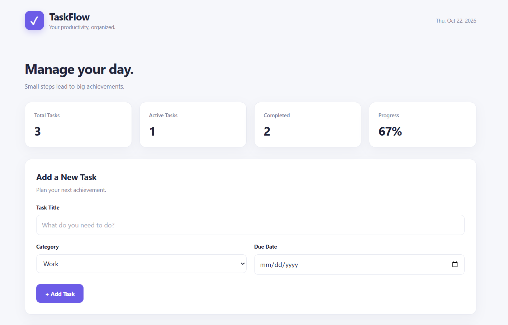
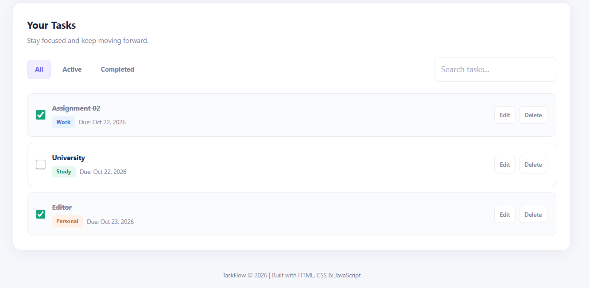
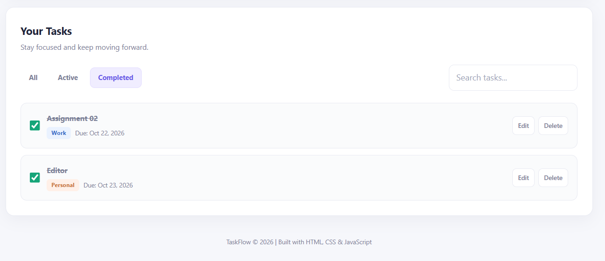

# Task 2 — Dynamic Task Manager & Productivity Tracker

A responsive task management application built as part of the **Datheon Full Stack Web Development Internship**. TaskFlow helps users organize daily activities, manage deadlines, track productivity, and maintain their tasks using browser local storage.

## 📌 Project Overview

**TaskFlow** is a front-end productivity application that allows users to create, manage, search, filter, and track tasks through a clean and responsive interface.

The project demonstrates practical skills in HTML5, CSS3, JavaScript ES6+, DOM manipulation, event handling, and browser local storage.

## ✨ Features

- **Create Tasks:** Add tasks with a title, category, and optional due date.
- **Read Tasks:** View saved tasks in an organized list.
- **Update Tasks:** Edit task titles and change completion status.
- **Delete Tasks:** Remove tasks with a confirmation prompt.
- **Task Categories:** Organize tasks into Work, Personal, and Study.
- **Task Filtering:** Filter tasks by All, Active, and Completed.
- **Search:** Find tasks by their titles.
- **Productivity Dashboard:** Track total, active, and completed tasks.
- **Progress Tracking:** View the completion percentage.
- **Persistent Storage:** Save tasks in browser local storage so they remain available after a page refresh.
- **Responsive Design:** Adapt the interface to desktop, tablet, and mobile screens.
- **Accessibility:** Use semantic HTML, accessible labels, visible keyboard focus, and reduced-motion preferences.

## 🛠️ Technologies Used

- HTML5
- CSS3
- JavaScript (ES6+)
- DOM Manipulation
- Browser Local Storage
- Git and GitHub

## 📂 Project Structure

```text
Task-2/
├── index.html
├── style.css
├── script.js
└── README.md
```

## 🚀 Getting Started

No backend, database server, package installation, or build tools are required.

### Prerequisites

- A modern web browser such as Google Chrome.
- A code editor such as Visual Studio Code.

### Installation

1. Clone or download this repository.
2. Open the `Task-2` folder in Visual Studio Code.
3. Ensure `index.html`, `style.css`, and `script.js` are in the same directory.
4. Open `index.html` in your browser, or use the VS Code Live Server extension.

### Usage

1. Enter a task title.
2. Select a category.
3. Optionally choose a due date.
4. Click **Add Task**.
5. Mark tasks as completed using the checkbox.
6. Use **Edit** or **Delete** to manage individual tasks.
7. Filter tasks by status or search for a task by title.
8. Refresh the page to verify that tasks remain saved.

## 💾 Data Persistence

TaskFlow uses the browser's `localStorage` API to store task data under the key `taskflow_tasks`.

Tasks are stored as JSON and loaded when the application initializes. This allows data to persist across page refreshes within the same browser origin.

**Note:** Tasks are stored locally in the browser, not on a remote server or shared database. Clearing browser storage or using a different browser or origin may make previously saved tasks unavailable.

## 🧪 Testing Checklist

- [x] Add a new task.
- [x] Display tasks in the task list.
- [x] Edit a task title.
- [x] Delete a task with confirmation.
- [x] Mark tasks as completed or active.
- [x] Filter tasks by status.
- [x] Search tasks by title.
- [x] Update dashboard statistics.
- [x] Preserve tasks after page refresh.
- [x] Apply responsive styling.

*Testing checklist reflects the core functionality verified during development.*

## 📸 Screenshots

### Dashboard


### Task List


### Completed Tasks


## 🎯 Learning Outcomes

This project provided practical experience with:

- Manipulating the DOM using JavaScript.
- Managing application state with arrays and objects.
- Handling form submissions and user events.
- Implementing CRUD operations.
- Using `localStorage` and JSON serialization.
- Filtering and searching application data.
- Updating UI statistics dynamically.
- Building responsive layouts with CSS Grid, Flexbox, and media queries.
- Writing basic accessible and maintainable front-end code.

## 🔮 Future Improvements

- Drag-and-drop task reordering.
- Edit tasks through an in-page modal.
- Task priority levels.
- Due-date reminders and overdue indicators.
- Export and import tasks.
- Backend integration and user authentication.

## 👨‍💻 Author

**Muhammad Hamza**

- GitHub: [mhummadhamza321-commits](https://github.com/mhummadhamza321-commits)
- LinkedIn: [Muhammad Hamza](https://www.linkedin.com/in/muhmmad-hamza-094639335/)

## 🏢 Internship

**Datheon — Full Stack Web Development Internship**

This project was developed as part of the internship's practical assignments.

---

⭐ If you find this project useful, feel free to explore the repository and follow my development journey.
