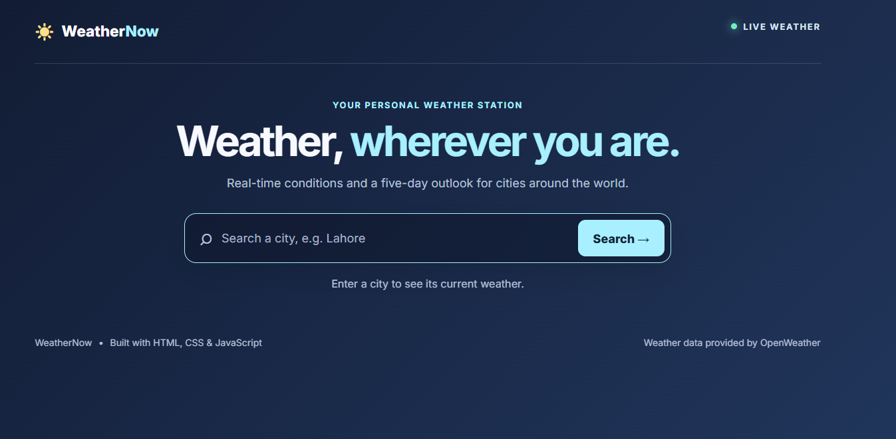
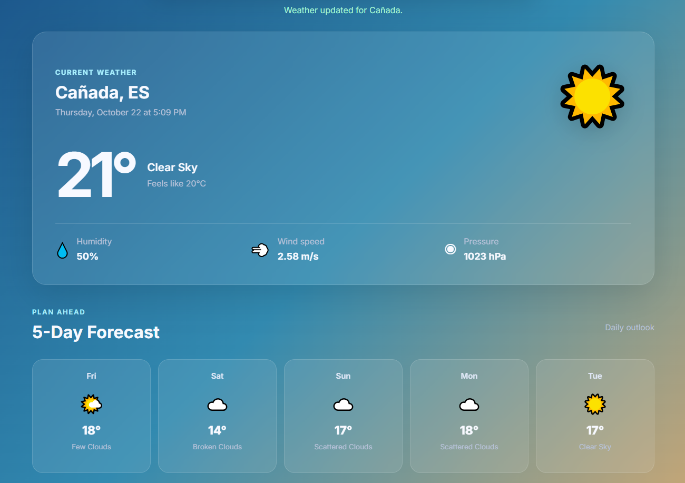
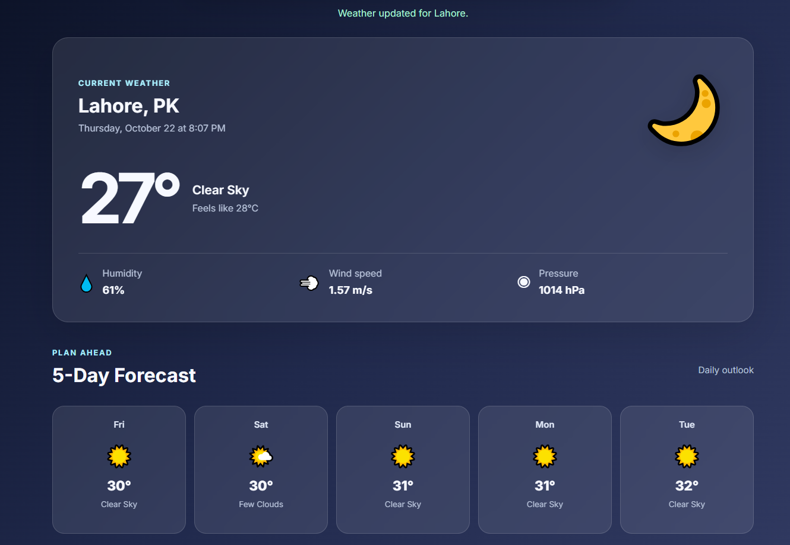
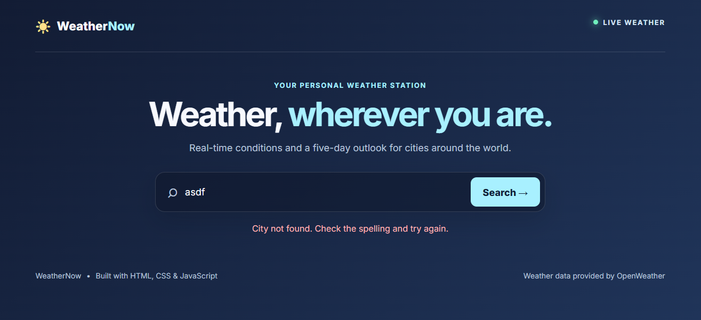
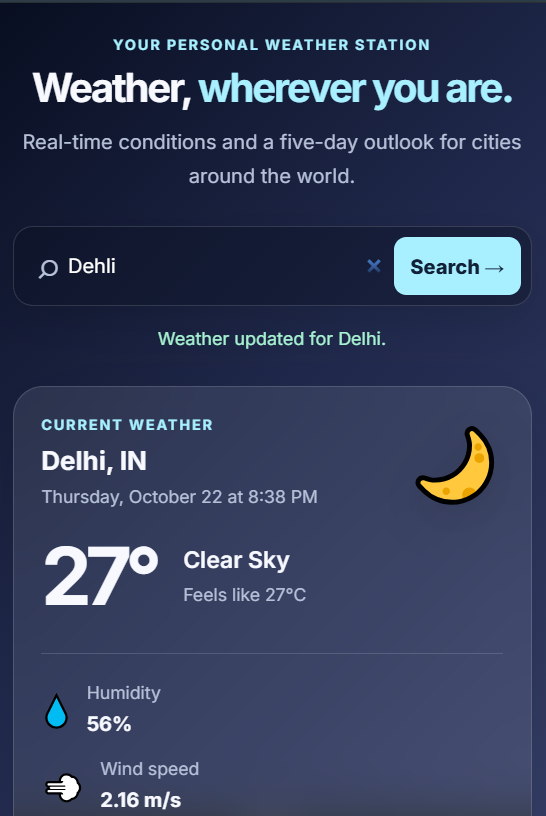

# WeatherNow — Real-Time Weather Forecast App

A responsive weather dashboard built with HTML, CSS, and vanilla JavaScript using the OpenWeather API.

## Features

- Search for cities around the world
- Current temperature and weather conditions
- Feels-like temperature, humidity, wind speed, and atmospheric pressure
- Five-day forecast cards
- Dynamic weather icons and background gradients
- Loading indicators and API error handling
- Responsive layout for desktop and mobile devices

## Technologies

- HTML5
- CSS3 — Flexbox, Grid, responsive media queries, gradients
- JavaScript — Fetch API, async/await, try/catch, DOM manipulation, Array methods
- OpenWeather API
- Git and GitHub

## Project Structure

```text
Task-3-Weather-App/
├── index.html
├── style.css
├── script.js
├── config.js
├── config.example.js
├── .gitignore
├── README.md
└── assets/
    └── screenshots/
```

## Setup Instructions

1. Clone or download this repository.
2. Create a local `config.js` file using `config.example.js` as a template.
3. Add your OpenWeather API key to `config.js`.
4. Open `index.html` using VS Code Live Server.
5. Search for a city to view weather conditions and forecast data.

## API Configuration and Security

The API key is not included in the repository. The local `config.js` file is excluded through `.gitignore`.

Note: A key used in browser-side JavaScript is not fully secret. A production deployment should use a backend proxy to protect credentials.

## Screenshots







## Author

Muhammad Hamza

## Project Status

Developed as part of a web development internship task.
