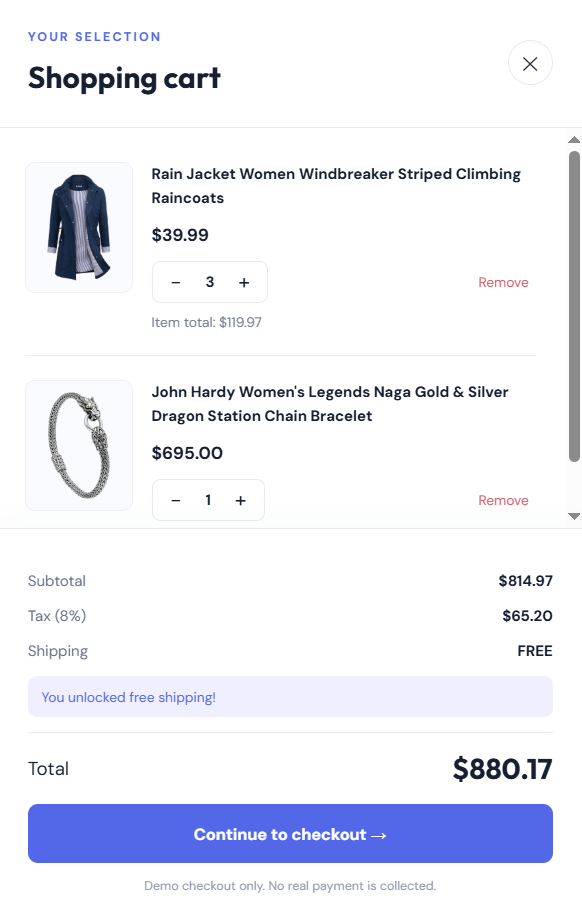
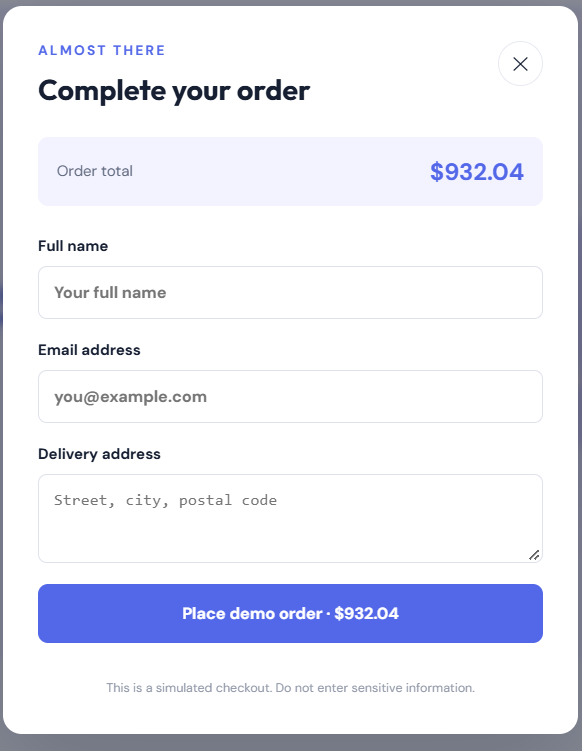

# E-Commerce Shopping Cart

A responsive e-commerce application built with React.js and Vite. The application fetches product data from the Fake Store API and provides an interactive shopping cart experience.

## Features

- Fetch and display products from the Fake Store API
- Product images, titles, prices, and details
- Add products to the shopping cart
- Increase and decrease product quantities
- Remove items from the cart
- Automatically calculate cart totals
- Responsive user interface

> Include search, category filters, checkout, or other features here only if they are implemented in your project.

## Technologies Used

- React.js
- Vite
- JavaScript
- CSS
- Fake Store API

## Screenshots

### Product Catalog


### Search and Filters


### Shopping Cart



### Checkout Confirmation



### Order Placed


## Installation and Setup

1. Clone or download this repository.
2. Open the project folder in your terminal.
3. Install dependencies:

   ```bash
   npm install
   ```

4. Start the development server:

   ```bash
   npm run dev
   ```

5. Open the local URL displayed in the terminal.

## Production Build

Run the following command to verify the production build:

```bash
npm run build
```

## API

Product data is retrieved from the [Fake Store API](https://fakestoreapi.com/products).

The application requires internet connectivity to fetch products from the API.

## Author

Muhammad Hamza

GitHub: [mhummadhamza321-commits](https://github.com/mhummadhamza321-commits)
